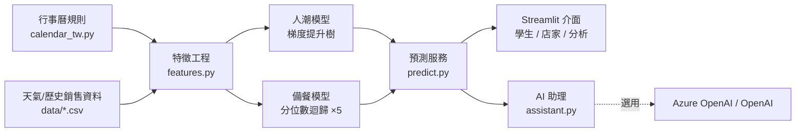

# 🍱 惜食預報 FoodCast：AI 學餐人潮與剩食預測系統

> **Microsoft × NCU AI Innovation Demo Day｜AI for Better Campus & Life**
> 機器學習概論 期末專題｜第 ＿ 組

用機器學習預測學餐**每 30 分鐘的人潮**與**每個品項的需求量**：

- 🎓 **學生**：知道幾點去最不用排隊
- 🧑‍🍳 **店家**：拿到「建議備餐量」，減少剩食，也減少賣完的情況

---

## 目錄
1. [專題簡介](#1-專題簡介)
2. [主要功能](#2-主要功能)
3. [系統架構](#3-系統架構)
4. [使用技術](#4-使用技術)
5. [安裝與執行](#5-安裝與執行)
6. [操作流程（Demo 腳本）](#6-操作流程demo-腳本)
7. [模型與評估結果](#7-模型與評估結果)
8. [資料說明與替換真實資料](#8-資料說明與替換真實資料)
9. [專案結構](#9-專案結構)
10. [限制與未來展望](#10-限制與未來展望)
11. [團隊分工](#11-團隊分工)

---

## 1. 專題簡介

**問題**
- 學生：午餐 12:00 前後大排長龍，下課只有短短時間，排隊排掉一半。
- 店家：只能憑經驗備餐。遇到下雨、考試週、連假前後，人潮變化大，常常不是**賣完**，就是**剩下很多變成廚餘**。

**解法**
我們把「行事曆（考試週、國定假日、寒暑假）」、「天氣（氣溫、雨量）」、「時段與星期幾」當作特徵，訓練兩個模型：

| 模型 | 預測目標 | 方法 |
|---|---|---|
| 人潮模型 | 每 30 分鐘的來客數 | 梯度提升樹迴歸（與 3 種方法比較後選出） |
| 備餐模型 | 每餐每品項需求的**分位數** | 分位數迴歸 (Quantile Regression) |

**成果（模擬資料回測，122 天測試期間）**：和「參考前兩週銷量 × 1.15」的備餐方式相比，
**剩食減少 63.6%**，需求滿足率從 94.8% 提升到 **97.0%**。

> ⚠️ 目前使用**模擬資料**驗證整套流程，數字代表「方法可行」，不代表真實學餐的實際成效。見[第 8 節](#8-資料說明與替換真實資料)。

## 2. 主要功能

| 頁面 | 功能 |
|---|---|
| 🏠 首頁 | 專題簡介、回測成果 KPI（剩食減少、滿足率、減碳、模型 R²） |
| 🎓 學生人潮預報 | 選日期與天氣 → 各時段人數與擁擠程度（舒適/普通/擁擠/爆滿）、推薦時段、未來 7 天熱度圖 |
| 🧑‍🍳 店家備餐建議 | 各品項「預期需求」與「建議備餐量」、可調整**服務水準**與**今日特餐**、**未來 7 天備餐計畫**、下載 CSV、剩食 vs 滿足率取捨曲線 |
| 📊 模型分析 | 4 種模型比較、特徵重要性、預測 vs 實際、每日剩食回測、**超參數調整（時間序列交叉驗證）** |
| 📤 上傳真實資料 | 上傳學餐 POS 銷售／人潮 CSV，自動檢查格式、補上行事曆特徵並重新訓練；可一鍵還原模擬資料 |
| 🤖 AI 助理 | 用中文問「明天中午幾點去人最少？」「晚餐要備幾份？」；有 API 金鑰時用 LLM 回答，沒有時用離線模式 |

**設計亮點**
- **服務水準可調**：q=70% 代表「有 70% 的機率需求不超過建議量」。店家可以自己決定多保守，這是把機器學習和「報童問題 (Newsvendor Problem)」結合的做法。
- **LLM 不碰數字**：AI 助理的所有數字都來自我們訓練的模型，LLM 只負責把結果講成口語，避免 LLM 自己編數字（幻覺）。
- **Demo 不怕斷網**：沒有金鑰或 LLM 呼叫失敗時，自動退回離線模式；模型檔不存在時，第一次開啟會自動訓練。

## 3. 系統架構



## 4. 使用技術

| 類別 | 技術 |
|---|---|
| 語言 | Python 3.10+ |
| 資料處理 | pandas、NumPy |
| 機器學習 | scikit-learn（HistGradientBoostingRegressor、RandomForestRegressor、LinearRegression、permutation_importance） |
| 介面 | Streamlit、Plotly |
| 生成式 AI（選用） | Azure OpenAI / OpenAI Chat Completions |
| 測試 | pytest、Streamlit AppTest |
| 協作 | Git、GitHub（branch + Pull Request） |
| AI 協作工具 | Claude、GitHub Copilot 等（詳見 AI 協作歷程報告） |

## 5. 安裝與執行

### 5.1 安裝
```bash
git clone https://github.com/<你們的帳號>/ncu-foodcast.git
cd ncu-foodcast

# 建議使用虛擬環境
python -m venv .venv
# Windows：
.venv\Scripts\activate
# macOS / Linux：
source .venv/bin/activate

pip install -r requirements.txt
```

### 5.2 產生資料並訓練模型（約 30 秒）
```bash
python -m foodcast.data_generator   # 產生模擬資料 → data/
python -m foodcast.train            # 訓練並評估模型 → models/
```
> 也可以跳過這一步。第一次開啟網頁時，若找不到模型會自動訓練。

### 5.3 啟動網頁
```bash
streamlit run app.py
```
瀏覽器會自動開啟 http://localhost:8501

### 5.4（選用）超參數調整
```bash
python -m foodcast.tuning      # 時間序列交叉驗證 + 網格搜尋，約 1～3 分鐘
```
結果會顯示在「模型分析」頁的第 5 節。

### 5.5 執行測試
```bash
python -m pytest -q
```

### 5.6（選用）啟用 LLM 模式
```bash
pip install openai
cp .env.example .env      # Windows 用 copy
# 編輯 .env，填入 Azure OpenAI 或 OpenAI 的金鑰
```
> 🔒 `.env` 已列在 `.gitignore`，**金鑰不會被上傳到 GitHub**。

## 6. 操作流程（Demo 腳本）

1. **首頁**：說明問題，指出四個 KPI。
2. **學生人潮預報**：
   - 選明天 → 看推薦時段與 12:00 尖峰
   - 把**雨量**拉到 20 mm → 人數上升（下雨少人外出）
   - 把日期改到**期末考週**的晚上 → 晚餐尖峰往後移
3. **店家備餐建議**：
   - 服務水準從 70% 調到 90% → 建議量增加
   - 看取捨曲線：AI 的每一個點都在「目前方式」的左上方
   - 選「今日特餐：咖哩飯」→ 咖哩飯建議量上升
4. **模型分析**：說明為什麼選梯度提升樹、哪些因素最重要。
5. **AI 助理**：點範例問題，或直接輸入「週五晚餐便當要備幾份？」。

## 7. 模型與評估結果

> 以下數字為在 Python 3.14、scikit-learn 最新版環境執行 `python -m foodcast.train` 的結果。不同套件版本可能有些微差異。

**資料切分**：依時間切分，訓練 2024/09/01–2026/02/28，測試 2026/03/01–2026/06/30（整個下學期，包含期中考、期末考、端午連假）。
時間序列資料**不能隨機切分**，否則等於用未來資料預測過去，評估結果會過度樂觀。

### 7.1 人潮模型（每 30 分鐘來客數，測試集）

| 模型 | MAE（人） | RMSE | R² |
|---|---|---|---|
| 歷史平均（基準線） | 43.04 | 58.68 | 0.737 |
| 線性迴歸 | 64.07 | 87.20 | 0.418 |
| 隨機森林 | 17.94 | 25.27 | 0.951 |
| **梯度提升樹（選用）** | **16.90** | **24.11** | **0.956** |

- 線性迴歸比基準線還差：人潮和時段、星期幾是**非線性**關係（12:00 尖峰、週五晚餐驟降），線性模型無法表達。
- 樹模型能自動學到交互作用，例如「考試週 × 晚餐」。
- 置換重要性：**用餐時段**、**星期幾**影響最大，其次是國定假日、是否學期中、雨量。

### 7.2 超參數調整（時間序列交叉驗證）

用 `python -m foodcast.tuning` 對梯度提升樹做網格搜尋（學習率 × 葉節點數 × 葉節點最少樣本，共 27 組），每組做 5-fold 時間序列交叉驗證：
- 只用訓練期間的資料，以「日期」為單位切分，永遠用較早的日子訓練、較晚的日子驗證，避免資訊洩漏。
- 結果：CV 最佳組合（learning_rate=0.03、max_leaf_nodes=15、min_samples_leaf=10）的 CV MAE 只比原本設定低約 0.85 人，小於各 fold 的標準差（約 3 人）；在測試集上反而略差（16.9 → 17.04）。
- 結論：差異屬於隨機波動，**維持原本設定**，避免對驗證資料過度調參。

### 7.3 備餐模型（分位數迴歸，測試期間 122 天）

| 備餐策略 | 總剩食 (kg) | 需求滿足率 |
|---|---|---|
| 目前方式（前兩週同一天銷量 × 1.15） | 16,261 | 94.8% |
| AI q=50% | 3,494 | 94.8% |
| AI q=60% | 4,490 | 95.8% |
| **AI q=70%（預設）** | **5,922** | **97.0%** |
| AI q=80% | 7,945 | 98.1% |
| AI q=90% | 11,232 | 99.0% |

在每一種服務水準下，AI 的剩食都比目前方式少，滿足率也比較高或相近。
以 q=70% 為例，剩食減少 **63.6%**。若以每公斤廚餘約 2.5 kg CO₂e 的估計值換算，約減少 25.8 噸 CO₂e（僅供呈現量級）。

## 8. 資料說明與替換真實資料

### 為什麼用模擬資料？
目前還沒有取得學餐的 POS 銷售資料，所以 `foodcast/data_generator.py` 依照以下**明確寫出的假設**產生兩個學年度的資料，先驗證整套流程能跑通：
- 午餐 12:00、晚餐 18:00 是尖峰；週五晚餐、週末、寒暑假人潮下降
- 考試週晚餐留校的人增加；下雨天學餐人數增加
- 天冷時湯麵比例上升，天熱時沙拉比例上升；今日特餐需求上升

### 替換成真實資料
把真實資料整理成以下欄位，覆蓋 `data/crowd.csv` 與 `data/demand.csv`，再執行 `python -m foodcast.train` 即可重新訓練：

| 檔案 | 必要欄位 |
|---|---|
| `crowd.csv` | `date, meal, slot, customers, temp, rain_mm, has_event` |
| `demand.csv` | `date, meal, dish, demand, is_promo, prep_current, temp, rain_mm, has_event` |

行事曆欄位（星期幾、考試週等）可以用 `foodcast.calendar_tw.day_features(date)` 自動補上。可行的真實資料來源：
- 店家 POS 機的銷售紀錄（最理想）
- 中央氣象署開放資料（氣溫、雨量）
- 學校官方行事曆
- 向同學發放的用餐時間問卷

## 9. 專案結構

```
ncu-foodcast/
├── app.py                  # 程式進入點：頁面設定與左側選單
├── pages/
│   ├── home.py             # 首頁
│   ├── student.py          # 學生人潮預報
│   ├── store.py            # 店家備餐建議
│   ├── analysis.py         # 模型分析
│   ├── upload.py           # 上傳真實資料
│   └── assistant.py        # AI 助理
├── foodcast/               # 核心程式（與介面分離，方便測試）
│   ├── config.py           # 共用設定：路徑、品項、成本、服務水準
│   ├── calendar_tw.py      # 校園行事曆規則
│   ├── data_generator.py   # 模擬資料產生器
│   ├── features.py         # 特徵工程（訓練與預測共用）
│   ├── train.py            # 模型訓練、比較與回測
│   ├── tuning.py           # 超參數調整（時間序列交叉驗證）
│   ├── data_io.py          # 真實資料格式檢查與匯入
│   ├── predict.py          # 預測服務
│   ├── assistant.py        # AI 助理（LLM + 離線模式）
│   └── ui.py               # 介面共用元件
├── tests/                  # 自動化測試（test_core.py、test_extensions.py）
├── data/                   # 資料（由程式產生，不上傳）
├── models/                 # 模型與評估結果（由程式產生，不上傳）
├── docs/                   # 簡報、報告、截圖
├── requirements.txt
├── .env.example            # 金鑰範本（真正的 .env 不上傳）
└── .gitignore
```

## 10. 限制與未來展望

**目前限制**
- 使用模擬資料，成效數字需要用真實銷售資料重新驗證。
- 天氣需要手動輸入，還沒有串接即時氣象 API。
- 上傳真實資料的功能已完成，但尚未取得學餐實際資料驗證。
- 只模擬單一餐廳、6 種品項。

**未來展望**
1. 與學餐店家合作取得 POS 資料，透過「上傳真實資料」頁重新訓練與驗證。
2. 串接中央氣象署 API，自動帶入天氣預報。
3. 加入學生回報「現在排隊人數」的功能，即時修正預測。
4. 擴展到多間餐廳，提供「哪一間現在人最少」的推薦。
5. 每週自動產生剩食報告給學校總務處，追蹤減廢成效。

## 11. 團隊分工

| 組員 | 學號 | 負責項目 |
|---|---|---|
| ＿＿＿（組長） | ＿＿＿ | 專案管理、資料模擬與行事曆規則 |
| ＿＿＿ | ＿＿＿ | 模型訓練與評估 |
| ＿＿＿ | ＿＿＿ | Streamlit 介面 |
| ＿＿＿ | ＿＿＿ | AI 助理與測試 |
| ＿＿＿ | ＿＿＿ | 簡報、README、AI 協作報告 |

---
本專題為課程作業與競賽作品。模擬資料與行事曆為簡化假設，不代表國立中央大學官方資料。
